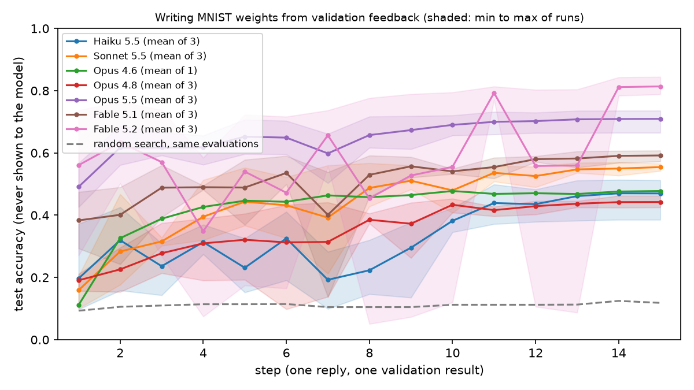
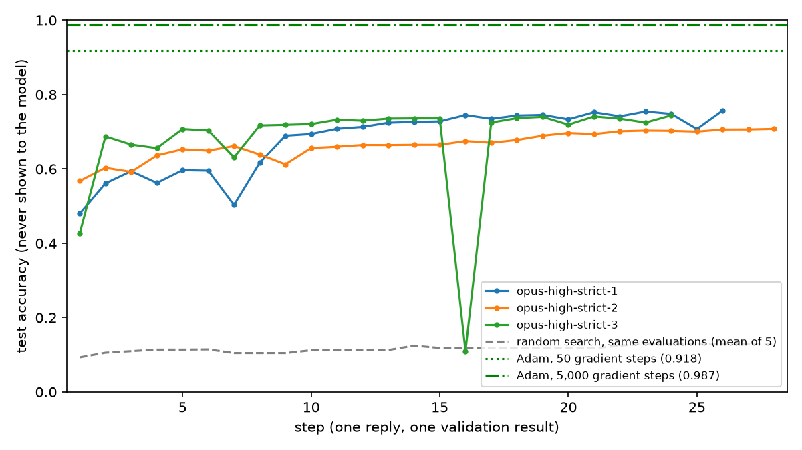

# MNIST training without gradients

Can an LLM train a small MNIST CNN by writing all of its weights, then improving them over 15 steps when the only
feedback is the validation loss, accuracy and confusion matrix? It never sees an image or a gradient.

The design is in [PROTOCOL.md](PROTOCOL.md), fixed before the first paid run.

## Setup

Needs macOS on Apple silicon (MLX), [uv](https://docs.astral.sh/uv/) and an `ANTHROPIC_API_KEY`.

```sh
cd mnist-training
uv sync
uv run python baselines.py                          # gradient descent and random search, about 30 seconds
uv run python loop.py --run-id plumbing --fake --steps 3   # free check: random weights, no API calls
```

## Running

Every step calls a paid model.

```sh
uv run python loop.py --run-id opus-high-strict-1     # 15 steps, claude-opus-5-5, effort high
uv run python loop.py --run-id opus-high-strict-1 --resume   # continue after an interruption
uv run python plots.py opus-high-strict-1             # figures in results/plots/
```

## Files

| Path | What it is |
|---|---|
| `prompts/task.md` | The first message: task, network, output format and rules |
| `prompts/feedback.md` | The message after each step |
| `network.py` | The fixed 5,994-parameter CNN in MLX, with PyTorch weight layout |
| `data.py` | MNIST download, hash check and the train / val / test split |
| `sandbox.py` | Runs each `build_weights()` with only numpy and math importable |
| `claude_client.py` | The conversation with Claude (Messages API), prices and cost per call |
| `loop.py` | The step loop (15 steps by default) |
| `baselines.py` | Adam and random-search reference points |
| `plots.py` | Accuracy curve, filters and confusion matrices |
| `compare.py` | Model comparison table (`results/comparison.md`) and chart (`results/plots/models.png`) |

Each run is saved in `results/<run-id>/`:

| Path | Contents |
|---|---|
| `run.json` | Model, effort, exact request settings, SDK and MLX versions, data and prompt hashes, prices, final scores, cost |
| `prompt.md` | The exact first message |
| `messages.json` | The whole conversation as sent to the API, thinking blocks included |
| `history.json` | One row per step: val and test loss and accuracy, errors, stop reason, time, cost, tokens |
| `steps/NN/message.md` | Exactly what was sent at that step |
| `steps/NN/reply.md` | The model's reply text |
| `steps/NN/thinking.md` | The model's summarised thinking |
| `steps/NN/response.json` | The raw API response |
| `steps/NN/submission.py` | The code that was run |
| `steps/NN/weights.npz` | The resulting weights |
| `steps/NN/metrics.json` | Sandbox result, val and test loss, accuracy and confusion matrix |
| `steps/NN/receipt.json` | Request ID, model, stop reason, token usage, cost, time |

`results/baselines/` holds the reference curves.

## Results

All runs use the strict rules in [PROTOCOL.md](PROTOCOL.md) unless noted. Test accuracy on the official MNIST test
set, which the model never sees.

### Model comparison at 15 steps

| Model | Runs | Step 1 (one-shot) | Step 15 | Mean step 15 | Cost per run | Minutes per run | Keyword hits |
|---|---:|---|---|---:|---|---|---|
| Haiku 5.5 | 3 | 12.1% / 9.7% / 37.2% | 51.2% / 51.2% / 38.6% | 47.0% | $0.12 / $0.10 / $0.07 | 12 / 9 / 7 | 0 |
| Sonnet 5.5 | 3 | 10.1% / 17.2% / 20.5% | 56.6% / 55.5% / 54.2% | 55.5% | $0.86 / $1.21 / $0.99 | 6 / 9 / 8 | 0 |
| Opus 4.6 | 1 | 11.2% | 47.8% | 47.8% | $17.29 | 84 | 0 |
| Opus 4.8 | 3 | 21.2% / 15.7% / 20.4% | 42.5% / 46.3% / 43.9% | 44.2% | $3.92 / $2.78 / $3.00 | 25 / 16 / 19 | 0 |
| Opus 5.5 | 3 | 48.0% / 56.8% / 42.6% | 72.8% / 66.5% / 73.6% | 71.0% | $2.32 / $2.74 / $2.10 | 13 / 15 / 11 | 0 |
| Fable 5.1 | 3 | 29.3% / 47.4% / 38.2% | 57.2% / 60.8% / 59.6% | 59.2% | $6.58 / $8.41 / $8.85 | 20 / 26 / 28 | 0 |
| Fable 5.2 | 3 | 27.1% / 67.5% / 73.7% | 78.9% / 84.5% / 80.8% | 81.4% | $16.31 / $13.47 / $17.51 | 51 / 43 / 51 | 0 |

Opus 4.6 has one run: two more were stopped during step 1 because of their cost and time, and their folders deleted.
"Keyword hits" counts submissions matching a pattern for random sampling or matrix fitting; zero hits is a screen,
not a full manual audit. Random search with the same number of validation evaluations reaches about 12%; Adam on
the same network reaches 91.8% after 50 gradient steps and 98.7% after 5,000 (`results/baselines/`).



### Fable 5.2 at low effort

Three more Fable 5.2 runs with `--effort low` (`results/fable52-low-strict-*`), otherwise identical: step 1 51.3% / 64.1% / 72.6%, step 15 76.1% / 73.2% / 79.9% (mean 76.4%), $4.72 / $5.22 / $7.41 a run. Runs 1 to 3 were interrupted by dropped connections and resumed with `--resume`. Fable 5.2 runs were made on 10 November 2026; the three `high` runs ran at the same time, so their minutes are not a clean timing comparison.

### Opus 5.5 until it flattens

The three Opus 5.5 runs were continued in the same conversations after step 15, with the budget extension and a
stopping rule stated to the model (see PROTOCOL.md). Each stopped when validation accuracy improved by less than
0.5 points over 5 steps.

| Run | Step 15 | Stopped at step | Final | Total cost |
|---|---:|---:|---:|---:|
| 1 | 72.8% | 26 | 75.7% | $4.83 |
| 2 | 66.5% | 28 | 70.8% | $5.67 |
| 3 | 73.6% | 24 | 74.4% | $3.90 |



### Loose-rules run

`results/opus-high-loose-rules-stopped/` is a first Opus 5.5 run whose prompt did not forbid fitting. From step 4 it
fitted a linear discriminant to synthetic digit features it generated itself, reaching 82.9% at step 14 before it was
stopped. It is kept for reference and is not comparable with the strict runs.

### Cost

Total for the saved runs: $70.86, computed from each response's token usage. Not included: two Opus 4.6 runs
stopped mid-reply without a usage receipt, and an earlier Claude Code attempt stopped during step 1.
